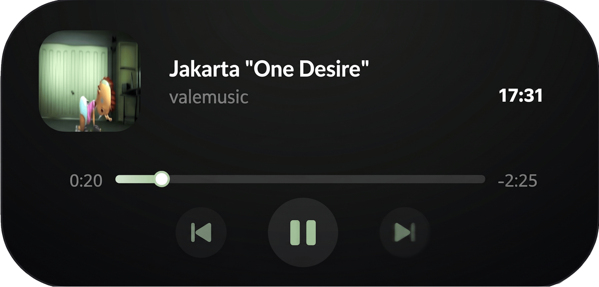

##English

# Dynamic Island Media Player for Windows

A focused, customizable Dynamic Island overlay for Windows that becomes an interactive media player when music or video is playing. This standalone mod is based on the original [Dynamic Island for Windows](https://github.com/devcode90/Dynamic-Island-for-Windows), but removes unrelated dashboard modules and concentrates on media playback.

## Features

### Media playback

* Reads the current media session through Windows System Media Transport Controls.
* Displays track title, artist, album, source-app badge, album artwork, and playback state.
* Provides play/pause, previous-track, and next-track controls.
* Supports progress display and scrubbing.
* Lets you choose the track-change animation: **Fade** (crossfade) or **Slide** (horizontal slide).
* Keeps track-change transitions independent from the option that disables the island's hover and movement animations.
* Refreshes album artwork when the track, artist, or album identity changes, and scales large artwork for display.

### Interaction and window behavior

* Expands on hover, with configurable behavior.
* Supports click-through mode; hold **Ctrl** to interact with the island.
* Provides configurable hotkeys for show/hide, next track, previous track, and play/pause.
* Supports per-application saved positions, so the island can appear at different locations for different apps.
* Includes always-on-top, above-games, taskbar-layering, and fullscreen options.
* Provides a right-click context menu for quick access to settings and playback-related options.

### Appearance and customization

* Multiple island shapes, including the default pill, Windows 11-style rounded box, and top-edge notch.
* Adjustable size, text scale, font, target monitor, and screen offsets.
* Theme presets and separate background, primary-text, and secondary-text colors.
* Accent color modes: automatic from album artwork, system accent, or custom color.
* User-managed color-morphing palette with add/remove/reset controls and adjustable speed.
* Configurable button style, shadow, and window opacity.
* Ukrainian, Russian, and English interface languages.
* Optional media-source filtering.

## Context menu and settings

Right-click the island to open its context menu. The menu includes window behavior, idle/paused visibility, opacity, color settings, color morphing, track-transition style, button style, language, animation and shadow options, hotkeys, media-source filtering, and per-app position controls.

The **Disable player animations** option affects the island's hover and movement animations. It does not disable Fade or Slide transitions between tracks.

## Credits

* **Himanshu (devcode90):** Original Dynamic Island for Windows framework, rendering foundation, and core interface design.
* **BOG090909:** Standalone media-player adaptation, per-app positioning, customization features, localization, playback integration, and performance improvements.

##Ukraine

# Динамічний острів медіаплеєра для Windows

Сфокусований і настроюваний оверлей Dynamic Island для Windows, який перетворюється на інтерактивний медіаплеєр під час відтворення музики чи відео. Цей самостійний мод створено на основі оригінального проєкту [Dynamic Island for Windows](https://github.com/devcode90/Dynamic-Island-for-Windows), але в ньому видалено зайві модулі інформаційної панелі та зосереджено увагу виключно на відтворенні медіафайлів.

## Можливості

### Відтворення медіа

* Читання поточної медіасесії через Windows System Media Transport Controls.
* Відображення назви треку, виконавця, альбому, значка вихідної програми, обкладинки альбому та стану відтворення.
* Надання елементів керування відтворенням/паузою, попереднім і наступним треками.
* Підтримка відображення прогресу та перемотування (скрубінгу).
* Можливість вибору анімації зміни треку: **Згасання** (кросфейд) або **Зсув** (горизонтальне перегортання).
* Збереження незалежності переходів між треками від опції, яка вимикає анімацію наведення та переміщення острова.
* Оновлення обкладинки альбому у разі зміни треку, виконавця або альбому, а також масштабування великих зображень для відображення.

### Взаємодія та поведінка вікна

* Розгортання при наведенні з можливістю налаштування поведінки.
* Підтримка режиму «клік крізь вікно» (click-through); утримуйте **Ctrl** для взаємодії з островом.
* Настроювані гарячі клавіші для приховування/показу, наступного треку, попереднього треку та відтворення/паузи.
* Підтримка збережених позицій для кожного додатка окремо, завдяки чому острів може з'являтися в різних місцях залежно від запущеної програми.
* Наявність опцій «поверх усіх вікон», поверх ігор, шарів панелі завдань та повноекранного режиму.
* Контекстне меню правою кнопкою миші для швидкого доступу до налаштувань і параметрів керування відтворенням.

### Зовнішній вигляд та кастомізація

* Кілька форм острова, зокрема стандартна пігулка, заокруглений блок у стилі Windows 11 та виріз на верхньому краї (notch).
* Регулювання розміру, масштабу тексту, шрифту, цільового монітора та зміщень на екрані.
* Пресети тем та окремі кольори для фону, основного тексту й вторинного тексту.
* Режими акцентного кольору: автоматичний з обкладинки треку, системний акцент або власний колір.
* Керована користувачем палітра злиття кольорів (колірного переливання) з елементами додавання/видалення/скидання та регулюванням швидкості.
* Настроювані стилі кнопок, тінь та прозорість вікна.
* Українська, російська та англійська мови інтерфейсу.
* Додаткова фільтрація медіadжерел.

## Контекстне меню та налаштування

Клацніть правою кнопкою миші по острову, щоб відкрити контекстне меню. Воно містить параметри поведінки вікна, видимості під час паузи чи неактивності, прозорості, кольорів, переливання кольорів, стилю переходу треків, стилю кнопок, мови, анімації та тіней, гарячих клавіш, фільтрації джерел медіа та керування позиціями для конкретних додатків.

Опція **Вимкнути анімації плеєра** впливає на анімацію наведення та переміщення острова. Вона не вимикає переходи (згасання або зсув) між треками.

## Подяки та автори

* **Himanshu (devcode90):** Оригінальний фреймворк Dynamic Island for Windows, фундамент рендерингу та дизайн інтерфейсу.
* **BOG090909:** Адаптація самостійного медіаплеєра, позиціонування для окремих додатків, функції кастомізації, локалізація, інтеграція відтворення та покращення продуктивності.
